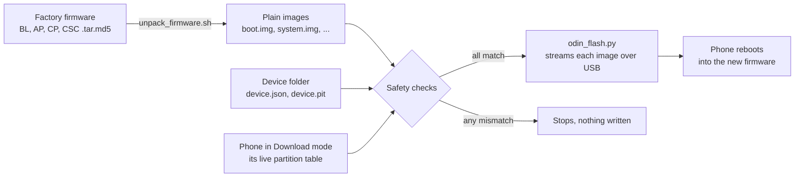
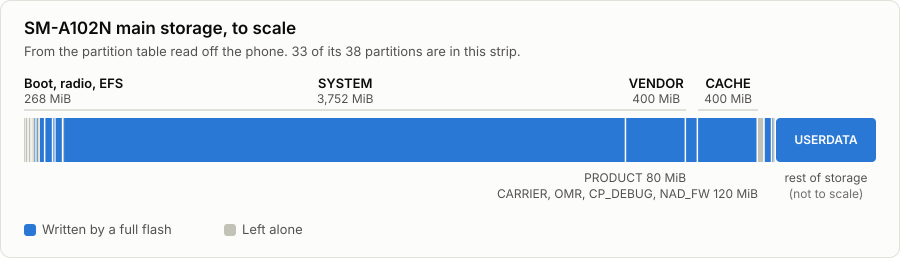
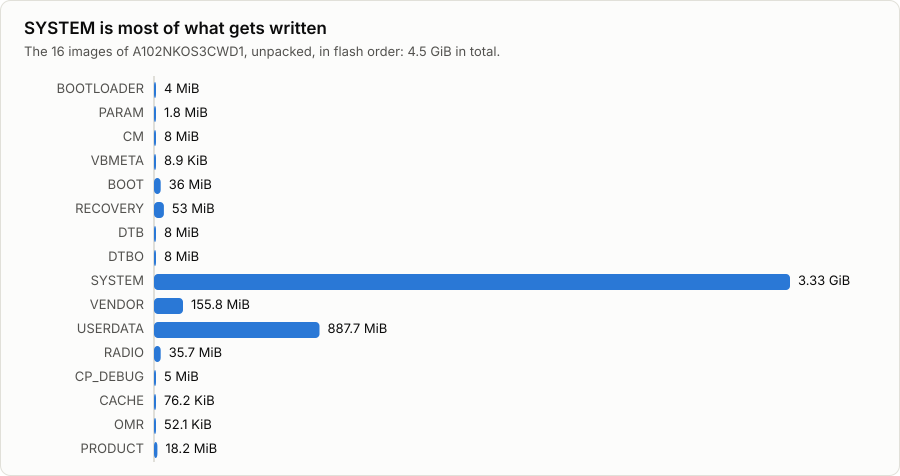

# Samsung Odin Flasher

Reinstall stock firmware on a Samsung phone from Linux, using a single Python file and no Windows PC.

It speaks Samsung's Odin Download mode protocol directly over Linux `usbfs`, with no libraries to install. Before it writes anything, it checks the phone's partition table and every image's SHA-256. Then it streams the firmware to the phone, and it stops at the first error.

It was built to recover a Galaxy A10e (SM-A102N) that Heimdall and Thor couldn't flash, and it's organised so other models can be added.



## Features

| Feature | Detail |
|---|---|
| **No dependencies** | One Python file using the standard library and Linux `usbfs` |
| **Checks before writing** | The live partition table must match byte for byte, every image hash must match, and each image must fit its partition |
| **Stops safely** | Exits at the first error and says where. Data that reached the phone is never resent |
| **Resumes cleanly** | `--from SYSTEM` continues at a partition, without writing the bootloader again |
| **Detects USB endpoints** | Reads them from the phone's USB descriptors |
| **Confirms before erasing** | You type the phone's model, so a wrong device folder gets noticed |
| **Handles strict bootloaders** | Sends the zero-length packets that end a command on phones that wait for them |
| **Tested without a phone** | A simulated bootloader covers normal flashing and failures such as refusals, silence and memory errors |

## Quick start

These steps are for the SM-A102N. **A full flash erases the phone.** The firmware isn't included in this repository, so get `A102NKOS3CWD1` for your exact model first.

```bash
git clone https://github.com/jakhon37/samsung-odin-flasher.git
cd samsung-odin-flasher
```

```bash
tools/check_firmware.sh ~/Downloads/A102NKOS3CWD1
```

```bash
tools/unpack_firmware.sh ~/Downloads/A102NKOS3CWD1 firmware/img
```

Put the phone in Download mode, connect it directly to the PC, then run:

```bash
python3 flasher/odin_flash.py --fresh --device devices/sm-a102n --images firmware/img
```

Writing takes about 3 minutes, and the phone then reboots by itself. The [SM-A102N guide](docs/sm-a102n.md) has every step, along with what to do when something goes wrong.

## Guides

| Guide | What it covers |
|---|---|
| [Flash the SM-A102N](docs/sm-a102n.md) | Step-by-step guide, options, error messages and first boot |
| [Any Samsung phone](docs/all-samsung.md) | Which reset you need, button combinations, firmware, Odin, Heimdall and Thor |
| [Add another model](docs/new-model.md) | Create a device folder from a phone's partition table and firmware |
| [Device details](docs/device.md) | Specifications, phone modes, USB details and full partition map |
| [How it works](docs/how-it-works.md) | The protocol, packet by packet, and how the fix was found |
| [Changelog](CHANGELOG.md) | What changed, and where this repository's history comes from |

## The phone's storage

<picture>
  <source media="(prefers-color-scheme: dark)" srcset="docs/images/storage-map-dark.svg">
  
</picture>

<picture>
  <source media="(prefers-color-scheme: dark)" srcset="docs/images/image-sizes-dark.svg">
  
</picture>

The numbers behind these charts are in [Device details](docs/device.md#partition-map).

## Repository layout

```text
flasher/odin_flash.py     The flasher
devices/sm-a102n/         This phone's image list and partition table
tools/
  check_firmware.sh       Verify the firmware's built-in checksums
  unpack_firmware.sh      Turn firmware tars into plain images
  new_device.py           Create a device folder for another model
  pit_info.py             Print a partition table
  odin_listen.py          Listen for a pending reply from the phone
  odin_zlp_test.py        Send one empty packet and show the reply
  usb_reset.py            Reset the phone's USB connection
tests/test_odin_flash.py  Simulated bootloader and tests
docs/                     Guides, diagrams and the script that draws the charts
```

## Testing

```bash
python3 tests/test_odin_flash.py
```

This needs no phone and takes about a second. Add a folder of real images to run them through the simulator too:

```bash
python3 tests/test_odin_flash.py firmware/img
```

On real hardware, an SM-A102N accepted all 16 images and then restarted. [What's been tested](docs/new-model.md#whats-been-tested) has the details for other models.

## Safety

- This can erase a phone and, like any flasher, could leave it needing repair. Use it at your own risk.
- Use only official firmware for your exact model, and only on phones you own or have permission to work on.
- It doesn't remove account locks or Factory Reset Protection.

This project isn't affiliated with or endorsed by Samsung. Firmware images are Samsung's and aren't distributed here.

## Credits

Protocol details come from reading [Thor](https://github.com/Samsung-Loki/Thor) by TheAirBlow and [Heimdall](https://github.com/Benjamin-Dobell/Heimdall) by Benjamin Dobell. This is a separate implementation in Python.

## License

[MIT](LICENSE)
