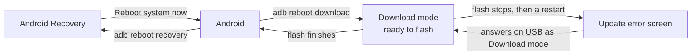
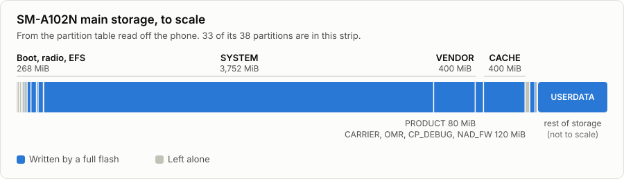
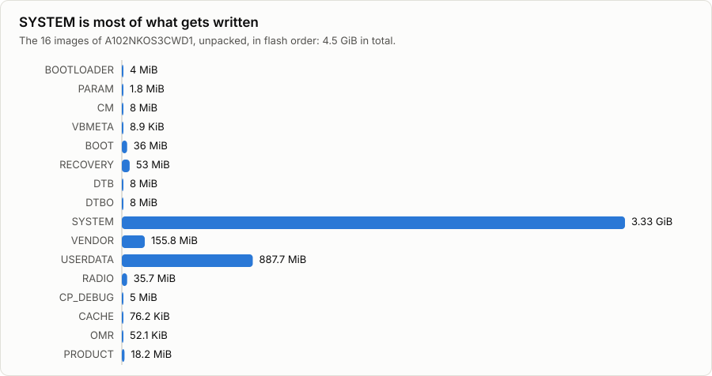
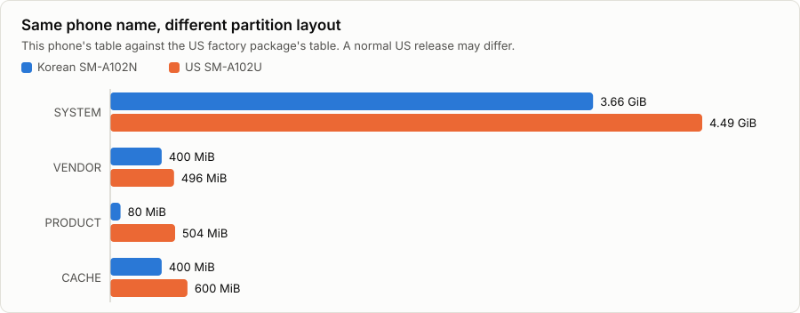

# Device details: Samsung Galaxy A10e, SM-A102N

The Korean model of the Galaxy A10e. Values marked **from the phone** were read from a real SM-A102N. The rest come from [Wikipedia](https://en.wikipedia.org/wiki/Samsung_Galaxy_A10e) and [DeviceBeast](https://devicebeast.com/devices/samsung-sm-a102n-galaxy-a10e-2019-td-lte-kr).

## Specifications

| | |
|---|---|
| Model | SM-A102N, Korean market |
| Chipset | Exynos 7884 |
| CPU | 2 × Cortex-A73 at 1.6 GHz, 6 × Cortex-A53 at 1.35 GHz |
| GPU | Mali-G71 MP2 |
| RAM | 2 GB or 3 GB, depending on the version |
| Storage | 32 GB, plus microSD up to 512 GB |
| Display | 5.83 in, 720 × 1560 |
| Battery | 3000 mAh |
| Connector | USB-C |
| Android | Launched with Android 9, latest is Android 11 |
| Firmware used here | `A102NKOS3CWD1` (April 2023, region `KOO`) |

## Phone modes

These are the states you'll move between, and how to get from one to the next.



**Holding Volume Down + Power for about 10 seconds** force-restarts the phone from any of these, and it's the only thing that clears a stuck session. Keep the cable connected while you do it. After a flash, the phone may also open Recovery by itself before it reaches Android.

| Mode | `lsusb -d 04e8:` shows (**from the phone**) | Notes |
|---|---|---|
| Download mode | `04e8:685d` | The name may say "GT-I9100", which is normal. Product string: `Gadget Serial` |
| Update error screen | `04e8:685d` | Works the same as Download mode |
| Android | `04e8:6860` | Product string: `SAMSUNG_Android` |
| Recovery | Nothing | The phone wasn't seen on USB in this mode |

Button combinations are in the [SM-A102N guide](sm-a102n.md#step-3-enter-download-mode).

## USB details in Download mode

**From the phone:**

| | |
|---|---|
| USB ID | `04e8:685d` |
| USB version | 2.00, high speed |
| Interface 0 | Class 2 (CDC control), interrupt endpoint `0x83`, 16-byte packets |
| Interface 1 | Class 10 (CDC data), bulk IN `0x81` and bulk OUT `0x02`, 512-byte packets |
| Protocol version | 3 (`0x00030000`) |
| Partition table | 8192 bytes, 38 entries, tag `COM_TAR2LSI7880` |
| Permissions | Works without `sudo` once the `heimdall-flash` package's USB rule is installed |

## Partition map

<picture>
  <source media="(prefers-color-scheme: dark)" srcset="images/storage-map-dark.svg">
  
</picture>

The full table, **from the phone**. To print it yourself:

```bash
python3 tools/pit_info.py devices/sm-a102n/device.pit
```

Offsets and sizes in the table are in 512-byte blocks and MiB. "Image" is the file a full flash writes to that partition; a blank means nothing does. A size of 0 means the bootloader decides it.

| ID | Offset | Size (MiB) | Partition | Image in the table | Written by this flash |
|---:|---:|---:|---|---|---|
| 80 | 0 | 4 | BOOTLOADER | `sboot.bin` | **Yes** |
| 90 | 6144 | 1 | DDI | | |
| 91 | 8192 | 0 | ECT | `ect.bin` | |
| 70 | 34 | 0.01 | PIT | | |
| 71 | 50 | 1 | MD5HDR | `md5.img` | |
| 1 | 8192 | 4 | BOTA0 | | |
| 2 | 16384 | 8 | BOTA1 | | |
| 3 | 32768 | 20 | EFS | `efs.img` | |
| 4 | 73728 | 20 | SEC_EFS | `sec_efs.img` | |
| 5 | 114688 | 8 | CPEFS | | |
| 6 | 131072 | 8 | BOTA2 | | |
| 7 | 147456 | 8 | CM | `cm.bin` | **Yes** |
| 8 | 163840 | 4 | m9kefs1 | `m9kefs1.bin` | |
| 9 | 172032 | 4 | m9kefs2 | `m9kefs2.bin` | |
| 10 | 180224 | 4 | m9kefs3 | `m9kefs3.bin` | |
| 11 | 188416 | 1 | NAD_REFER | `nad_refer.bin` | |
| 12 | 190464 | 8 | PARAM | `param.bin` | **Yes** |
| 13 | 206848 | 8 | UP_PARAM | `up_param.bin` | |
| 14 | 223232 | 2 | MISC | | |
| 15 | 227328 | 36 | BOOT | `boot.img` | **Yes** |
| 16 | 301056 | 53 | RECOVERY | `recovery.img` | **Yes** |
| 17 | 409600 | 8 | DTB | `dt.img` | **Yes** |
| 18 | 425984 | 8 | DTBO | `dtbo.img` | **Yes** |
| 19 | 442368 | 50 | RADIO | `modem.bin` | **Yes** |
| 20 | 544768 | 0.5 | PERSISTENT | | |
| 21 | 545792 | 4 | STEADY | `steady.bin` | |
| 22 | 553984 | 0.5 | VBMETA | `vbmeta.img` | **Yes** |
| 23 | 555008 | 0.5 | BOTA3 | | |
| 24 | 556032 | 0.5 | RESERVED2 | | |
| 25 | 557056 | 3752 | SYSTEM | `system.img` | **Yes** |
| 26 | 8241152 | 400 | VENDOR | `vendor.img` | **Yes** |
| 27 | 9060352 | 80 | PRODUCT | `product.img` | **Yes** |
| 28 | 9224192 | 400 | CACHE | `cache.img` | **Yes** |
| 29 | 10043392 | 45 | CARRIER | `carrier.img` | |
| 30 | 10135552 | 50 | OMR | `omr.img` | **Yes** |
| 31 | 10237952 | 5 | CP_DEBUG | `modem_debug.bin` | **Yes** |
| 32 | 10248192 | 20 | NAD_FW | `nad_fw.bin` | |
| 33 | 10289152 | 0 | USERDATA | `userdata.img` | **Yes** |

`EFS` and `SEC_EFS` hold data specific to each phone, such as its network identity. A normal flash leaves them alone, and you should keep it that way.

## What gets written

<picture>
  <source media="(prefers-color-scheme: dark)" srcset="images/image-sizes-dark.svg">
  
</picture>

| Tar | Images, in flash order |
|---|---|
| `BL` | `sboot.bin`, `param.bin`, `cm.bin`, `vbmeta.img` |
| `AP` | `boot.img`, `recovery.img`, `dt.img`, `dtbo.img`, `system.img`, `vendor.img`, `userdata.img` |
| `CP` | `modem.bin`, `modem_debug.bin` |
| `CSC` | `cache.img`, `omr.img`, `product.img` |

`vbmeta.img` appears in both `BL` and `AP`. The two copies are identical, so it's written once.

## Korean and US versions

Both sell as the "Galaxy A10e", but US firmware is built for different models: the SM-A102U (carrier) and SM-A102U1 (unlocked). **Don't flash it onto an SM-A102N.** This tool refuses, because the partition tables don't match.

<picture>
  <source media="(prefers-color-scheme: dark)" srcset="images/region-partitions-dark.svg">
  
</picture>

| | Korean SM-A102N | US SM-A102U |
|---|---|---|
| `SYSTEM` | 3.66 GiB | 4.49 GiB |
| `VENDOR` | 400 MiB | 496 MiB |
| `PRODUCT` | 80 MiB | 504 MiB |
| `CACHE` | 400 MiB | 600 MiB |
| Radio firmware | 37.4 MB | 46.8 MB in the factory package |
| Partition table | `A10E_KOR_OPEN.pit` | `A10E_USA_SINGLE.pit` |

The US values come from a factory test package, `A102USQUAAUD1`, so a normal US release may differ in detail.

**Why it's a bad idea:**

- The bootloader normally rejects firmware for another model. That's general Samsung behaviour, not tested on this phone.
- It would need repartitioning, one of the riskiest kinds of flash.
- Radio firmware is matched to the model, so calls and data could stop working.
- Firmware can't add radio bands the hardware doesn't have.

**What to do instead:** English menus are in **Settings > General management > Language**, unwanted apps can be disabled in **Settings > Apps**, and US carriers can check this model's compatibility from its IMEI.
