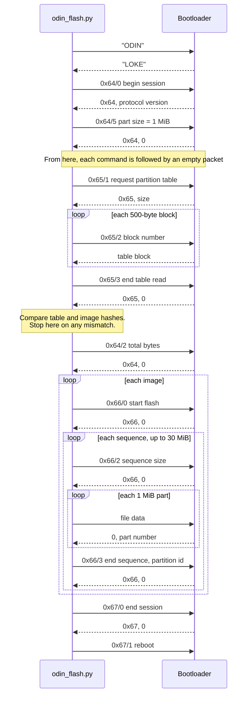
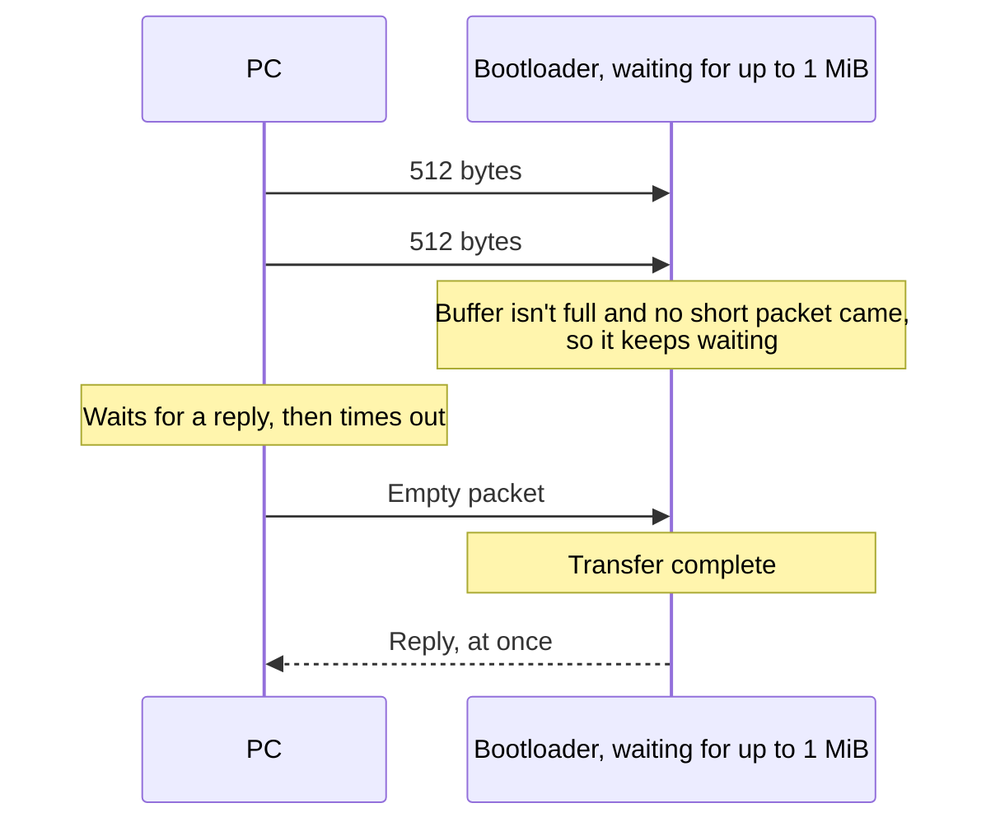
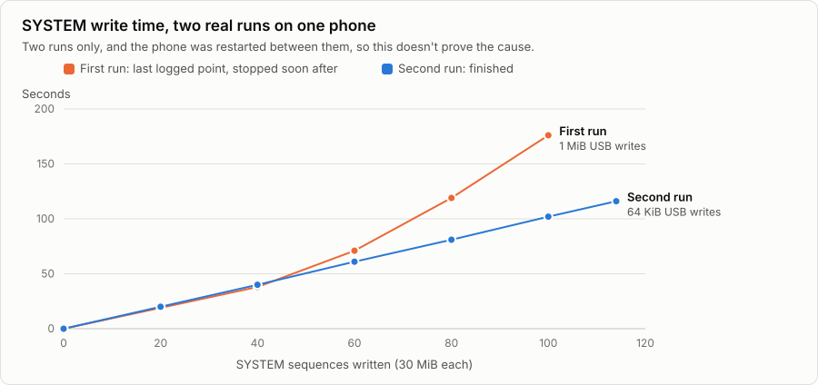

# How it works

This covers the Odin protocol as this tool uses it, why other Linux tools failed on the SM-A102N, and how the fix was found.

## The flash, packet by packet

Download mode talks over two USB bulk endpoints on a CDC data interface. Every command is a 1024-byte packet starting with two little-endian integers: a command group and an action. Most replies are 8 bytes: the group, then a value. A first byte of `0xFF` means the phone refused.



### Commands

| Group | Action | Meaning |
|---|---|---|
| `0x64` | `0` | Begin session. The reply carries the protocol version |
| `0x64` | `2` | Total bytes to be sent, as a 64-bit integer |
| `0x64` | `5` | Set the file part size |
| `0x65` | `1`, `2`, `3` | Read the partition table: request, read a block, finish |
| `0x66` | `0` | Start flashing one image |
| `0x66` | `2` | Start a sequence of parts |
| `0x66` | `3` | End a sequence. Gives the real byte count, device type, partition id and an end-of-file flag |
| `0x67` | `0`, `1` | End the session, then reboot |

### Refusal codes

When the phone refuses the end of a sequence, the value in its reply gives the reason:

| Code | Meaning |
|---|---|
| `-2` | Write protect |
| `-3` | Erase failed |
| `-4` | Write failed |
| `-5` | Authentication: signature rejected |
| `-6` | Size |
| `-7` | Ext4 image |

## The empty packet

USB bulk transfers end in one of two ways: the receiver's buffer fills up, or a packet shorter than the maximum arrives. On this phone the maximum packet is 512 bytes.

After `0x64/5` sets the part size to 1 MiB, the bootloader waits for up to 1 MiB of data. The next command is 1024 bytes, which is exactly two full packets. Nothing marks its end, so the bootloader keeps waiting. An empty packet ends the transfer, and the phone then acts on the command.



Heimdall sends these packets by default. Thor has the code for them behind a flag that's never turned on.

File data doesn't need them, because each part is exactly 1 MiB and fills the buffer. If an acknowledgement doesn't arrive, the flasher sends one empty packet in case the phone is waiting, and stops if there's still no answer.

## How the fix was found

Here's the sequence on the SM-A102N, which was part-flashed and stuck on Samsung's "firmware update error" screen. Times are local, from one night's logs.

| Time | Attempt | Result | What it showed |
|---|---|---|---|
| Before | Heimdall 2.0.2, five times | Stops at "Beginning session" | Heimdall can see the phone but not start a session |
| 06:01 | Thor 1.1.0 | Session opens, then `Connection timed out` reading the table | Thor gets further than Heimdall |
| 06:02 | Thor on the same connection | `Value too large` on the handshake | The phone sent more than expected, so it's alive |
| 06:03 | Thor after a USB reset | No handshake reply | A USB reset isn't enough |
| 06:08 | Thor and Heimdall after a replug | No handshake reply | Neither is a new connection |
| 06:16 | Thor after a forced restart | Session opens, then the same timeout, at the table request's first reply | **Only a restart clears a stuck session** |
| Next | Listening for 25 seconds | Nothing arrives | The phone isn't slow. It hasn't acted on the command |
| Next | One empty packet | Instant reply `65 00 00 00 00 20 00 00`: an 8192-byte table | **The cause is confirmed** |
| 06:33 | First full flash, with this tool | 8 images accepted, then `ENOMEM` during SYSTEM | The protocol works. The failure is on the PC |
| 06:48 | Second run, from SYSTEM, 64 KiB writes | All remaining images accepted in 155 seconds | Finished |

### Dead ends worth knowing

- **Linux's serial driver and ModemManager** looked like likely culprits, but neither was attached to the phone.
- **"Heimdall prepares the connection for Thor"** fit the first few results, but a clean test ruled it out.

### Why USB writes went to 64 KiB

`usbfs` allocates one contiguous kernel buffer for each transfer. The first run used 1 MiB transfers, and one failed with `ENOMEM` past sequence 100 of `SYSTEM`. The kernel log recorded nothing about it, so a lack of contiguous memory is the likely cause rather than a proven one.

Splitting each part into 64 KiB chunks doesn't change what the phone sees, because chunks of whole packets contain no short packet.

<picture>
  <source media="(prefers-color-scheme: dark)" srcset="images/system-timing-dark.svg">
  
</picture>

| Sequences | First run, 1 MiB writes | Second run, 64 KiB writes |
|---:|---:|---:|
| 20 | 19 s | 20 s |
| 40 | 38 s | 40 s |
| 60 | 71 s | 61 s |
| 80 | 119 s | 81 s |
| 100 | 176 s | 102 s |
| 114 | stopped earlier | 116 s |

The second run stayed steady, but this is only two runs with a phone restart between them. The chunk size may not be why.

## Why stopping is safe

| Step | What protects it |
|---|---|
| Wrong phone or firmware | The live partition table must match `device.pit` exactly, and images must fit their partitions |
| Damaged files | Each image's SHA-256 is checked before the flash, and again on the bytes actually read for sending |
| Wrong device folder | You type the model to confirm |
| A failed write | The tool stops and names the partition. Restart the phone and continue with `--from` |
| Memory errors | Retried, because `ENOMEM` happens before any data reaches the USB bus |

Anything else, including a missing acknowledgement, stops the flash. A resend could write data in the wrong place, so a stopped partition is written again from its start on the next run.

## Regenerating the charts

The partition charts read `devices/sm-a102n/`. Timing and US values are at the top of the script, which needs only the standard library.

```bash
python3 docs/make_figures.py
```
